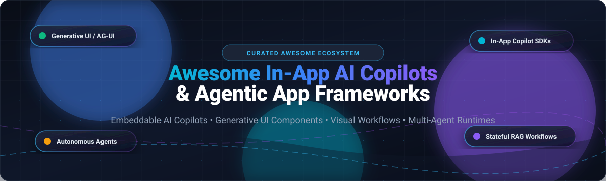

# Awesome In-App AI Copilots & App Frameworks 🤖✨

  

  <a href="https://github.com/ishandutta2007/Awesome-Awesome-Awesome">/</a>
  
  
  
  

> 🌟 **A comprehensive, battle-tested curated catalog of in-app AI copilots, embeddable agentic UI frameworks, generative UI toolkits, conversational chat interfaces, full-stack AI portals, and visual workflow builders.** Discover commercial SaaS & enterprise platforms alongside top open-source (FOSS) alternatives.

---

## 📑 Table of Contents

- [📊 Sector Overview & Market Dynamics](#-sector-overview--market-dynamics)
- [☁️ SaaS & Hosted Commercial Platforms](#️-saas--hosted-commercial-platforms)
- [🛠️ Open-Source Equivalents & Developer Frameworks](#️-open-source-equivalents--developer-frameworks)
  - [🎨 In-App AI Copilot & Generative UI Frameworks](#-in-app-ai-copilot--generative-ui-frameworks)
  - [🖥️ Full-Stack Self-Hosted AI Chat & Copilot Portals](#️-full-stack-self-hosted-ai-chat--copilot-portals)
  - [🔀 Visual Agent & Workflow Builders (No-Code / Low-Code)](#-visual-agent--workflow-builders-no-code--low-code)
  - [⚡ Developer SDKs & Agentic Application Runtimes](#-developer-sdks--agentic-application-runtimes)
  - [💬 Embeddable Chat Widgets & Browser Copilot Extensions](#-embeddable-chat-widgets--browser-copilot-extensions)
- [📈 Star History](#-star-history)
- [🤝 Contributing](#-contributing)
- [💖 Support & Sponsorship](#-support--sponsorship)

---

## 📊 Sector Overview & Market Dynamics

The global conversational AI and in-app AI copilot market is estimated at approximately $14 billion to $17 billion in 2025, expanding at a rapid compound annual growth rate (CAGR) of ~22%–24%. The sector exhibits a distinct bifurcated market dynamic: it is **highly concentrated** at the foundational model and enterprise suite tier (dominated by hyperscalers and established suite incumbents like Salesforce, Zendesk, and Microsoft), yet **highly fragmented** across the application and embeddable UI copilot layer where fast-moving startups and open-source frameworks continuously emerge to serve specialized domain workflows.

---

## ☁️ SaaS & Hosted Commercial Platforms

Commercial, cloud-hosted AI copilot platforms, managed agent builders, proprietary browser extensions, and enterprise conversational SaaS tools.

| Company / Product | Valuation / Revenue | Starting Pricing Tier | Free Tier Limits | Description |
| :--- | :--- | :--- | :--- | :--- |
| **[Zendesk AI](https://zendesk.com)** | Valuation: ~$10.2B (take-private) / Revenue: ~$2.0B ARR | $55/agent/month (Suite Team) + $1.50–$2.00 per automated resolution | 14-day free trial (Suite Professional tier features; includes baseline 5 automated AI resolutions per agent) | Enterprise customer service platform with built-in AI copilot, omnichannel routing, and autonomous resolution agents. |
| **[Intercom Fin](https://intercom.com)** | Valuation: ~$3.6B (acquired by Salesforce) / Revenue: ~$400M ARR | $29/seat/month (Essential plan) + $0.99 per successful Fin AI outcome | 14-day free trial (full access to core platform features and unlimited Fin AI resolution outcomes during the 14 days) | Leading customer-facing AI agent and copilot embedded directly into web apps to handle support tickets and resolutions. |
| **[Langflow (DataStax / IBM)](https://langflow.org)** | Valuation: ~$1.6B (DataStax peak prior to IBM acquisition) / Revenue: ~$240M ARR | Free Open-Source self-hosted ($0); cloud enterprise managed via IBM / Astra DB | Free forever via self-hosted MIT open-source software (unlimited local pipelines/nodes; self-provided LLM API keys) | Visual framework and orchestrator for prototyping, fine-tuning, and deploying LangChain/Python-based multi-agent workflows. |
| **[Flowise Cloud](https://flowiseai.com)** | Valuation: Acquired by Workday ($500K YC seed; ~$1M ARR prior to exit) | $35/month (Starter tier) | Free forever plan: 2 flows, 2 assistants, 100 predictions/month, and 5 MB storage | Hosted cloud service for building and scaling drag-and-drop LLM orchestration flows and multi-agent systems. |
| **[Dify Cloud](https://dify.ai)** | Valuation: ~$180M (Series Pre-A) / Revenue: ~$3.1M ARR | $59/month (Professional plan; or $49.17/mo billed annually) | Free forever Sandbox plan: 200 lifetime message credits, 1 team member, 5 apps, and 50 MB knowledge base storage | Fully managed LLMOps platform for visually orchestrating RAG pipelines, AI agents, and production APIs. |
| **[Botpress Cloud](https://botpress.com)** | Valuation: ~$120M (Series B) / Revenue: ~$10M ARR | $150/month (Plus plan billed annually; or $189/mo month-to-month) | Free forever tier: 100 monthly conversations, up to 3 bots/agents, 3 team seats, and base AI studio access | Commercial all-in-one AI agent platform featuring a visual studio, autonomous nodes, and multi-channel deployment. |
| **[Voiceflow](https://voiceflow.com)** | Valuation: ~$105M (Series A/Financing) / Revenue: ~$30M ARR | $60/month (Pro tier) | Free forever Starter plan: 100 non-renewing lifetime credits, 1 editor seat, 2 project agents (testing/prototype use only) | Collaborative commercial platform for designing, prototyping, and deploying conversational voice and chat AI agents. |
| **[CopilotKit Cloud](https://copilotkit.ai)** | Valuation: ~$100M–$250M (Series A) / Revenue: Early commercial (F500 contracts) | $49/month (Pay-As-You-Go developer tier) | Free forever Developer edition: 1 seat, non-production prototyping, 200 threads, 3-day retention, and 1 GB storage | Managed cloud infrastructure and hosted runtime for embedding in-app AI copilots, agentic state sync, and generative UI into React apps. |
| **[Superpower ChatGPT](https://superpowerdaily.com)** | Valuation: Bootstrapped / Independent ($15/mo Pro tier) | $15/month (or $10/month billed annually) | Free forever extension plan: capped at 5 folders, 5 saved prompts, and 2 custom instruction profiles | Commercial browser extension enhancing web AI interfaces with prompt chains, folder organization, custom profiles, and history search. |

---

## 🛠️ Open-Source Equivalents & Developer Frameworks

Free and open-source software (FOSS) in-app copilot toolkits, generative UI SDKs, self-hosted ChatGPT portals, developer runtimes, and visual agent builders. Sorted by GitHub Stars_Count in descending order.

### 🎨 In-App AI Copilot & Generative UI Frameworks

* **[CopilotKit](https://github.com/CopilotKit/CopilotKit)**  - The leading open-source framework for building deeply integrated in-app AI copilots, context-aware chatbots, and generative UI components in React.
* **[OpenUI](https://github.com/wandb/openui)**  - Open-source tool allowing developers to describe UI components in natural language and render live interactive web components in real time.
* **[assistant-ui](https://github.com/assistant-ui/assistant-ui)**  - Composable, accessible open-source TypeScript/React primitives for building production-grade AI chat and copilot interfaces.
* **[Tambo AI](https://github.com/tambo-ai/tambo)**  - Open-source generative UI engine enabling web applications to stream and render interactive UI components safely.
* **[NLUX](https://github.com/nluxai/nlux)**  - Lightweight, zero-dependency open-source JavaScript and React library for conversational AI user interfaces.

### 🖥️ Full-Stack Self-Hosted AI Chat & Copilot Portals

* **[Open WebUI](https://github.com/open-webui/open-webui)**  - Feature-rich, extensible self-hosted AI interface supporting Ollama, OpenAI-compatible APIs, built-in RAG, and web search.
* **[RAGFlow](https://github.com/infiniflow/ragflow)**  - Open-source RAG engine based on deep document understanding for enterprise retrieval and copilot systems.
* **[ChatGPT-Next-Web (NextChat)](https://github.com/ChatGPTNextWeb/ChatGPT-Next-Web)**  - Cross-platform, one-click deployable open-source web and desktop AI assistant interface with low resource overhead.
* **[LobeChat](https://github.com/lobehub/lobe-chat)**  - Modern open-source AI agent workspace featuring plugin ecosystems, voice synthesis, artifact rendering, and multimodal models.
* **[LibreChat](https://github.com/danny-avila/LibreChat)**  - Enhanced open-source ChatGPT clone supporting multiple AI providers, MCP (Model Context Protocol), artifacts, and multi-user auth.
* **[Chatbox](https://github.com/Bin-Huang/chatbox)**  - Open-source desktop and mobile client for ChatGPT, Claude, and local LLMs with prompt templates and multi-model switching.
* **[Khoj](https://github.com/khoj-ai/khoj)**  - Self-hosted open-source personal AI copilot capable of searching local documents, automating research, and running across web and desktop.
* **[Chatbot UI](https://github.com/mckaywrigley/chatbot-ui)**  - Clean, open-source AI chat interface designed for effortless deployment across local and cloud LLM providers.
* **[FastGPT](https://github.com/labring/FastGPT)**  - Knowledge-base platform built on LLMs for out-of-the-box data processing, automated QA, and customer copilot portals.

### 🔀 Visual Agent & Workflow Builders (No-Code / Low-Code)

* **[n8n](https://github.com/n8n-io/n8n)**  - Fair-code/open-source workflow automation tool with native LangChain AI agent nodes for building backend copilot automations.
* **[AutoGPT](https://github.com/Significant-Gravitas/AutoGPT)**  - Accessible, open-source platform enabling developers to build, test, and deploy autonomous multi-agent workflows.
* **[Dify](https://github.com/langgenius/dify)**  - Open-source LLM app development platform combining Backend-as-a-Service and LLMOps with visual workflow orchestration.
* **[Langflow](https://github.com/langflow-ai/langflow)**  - Open-source visual framework for building multi-agent and RAG applications with Python customization and instant API endpoints.
* **[Flowise](https://github.com/FlowiseAI/Flowise)**  - Open-source drag-and-drop visual UI builder to construct customized LLM flows, RAG chatbots, and multi-agent architectures.
* **[Activepieces](https://github.com/activepieces/activepieces)**  - Open-source business automation platform with pre-built AI agent workflows and hundreds of app connectors.
* **[Rasa](https://github.com/RasaHQ/rasa)**  - Mature open-source machine learning framework for automated text and voice-based conversational assistants.
* **[Botpress](https://github.com/botpress/botpress)**  - Open-source conversational AI runtime and NLU engine for building extensible chatbots and messaging integrations.

### ⚡ Developer SDKs & Agentic Application Runtimes

* **[AutoGen](https://github.com/microsoft/autogen)**  - A programming framework for agentic AI by Microsoft enabling multi-agent conversation and cooperation.
* **[CrewAI](https://github.com/crewAIInc/crewAI)**  - Lean, powerful framework for orchestrating role-playing autonomous AI agents and team collaborations.
* **[LangGraph](https://github.com/langchain-ai/langgraph)**  - Open-source library for building stateful, multi-actor agentic applications with cycles, persistence, and human-in-the-loop control.
* **[Mastra](https://github.com/mastra-ai/mastra)**  - Open-source TypeScript agent framework providing workflows, RAG, memory, and tool calling for modern web applications.
* **[Vercel AI SDK](https://github.com/vercel/ai)**  - Open-source TypeScript toolkit designed to help developers build AI-powered streaming text and generative user interfaces in React, Next.js, and Vue.
* **[Haystack (deepset)](https://github.com/deepset-ai/haystack)**  - End-to-end open-source LLM orchestration framework for building custom RAG pipelines, semantic search, and conversational agents.
* **[PydanticAI](https://github.com/pydantic/pydantic-ai)**  - Open-source Python agent framework engineered to bring FastAPI-style type safety and ergonomics to production GenAI apps.

### 💬 Embeddable Chat Widgets & Browser Copilot Extensions

* **[Chatwoot](https://github.com/chatwoot/chatwoot)**  - Open-source customer engagement suite offering an embeddable live-chat widget extensible with AI bots and AgentBot webhooks.
* **[Typebot](https://github.com/baptisteArno/typebot.io)**  - Open-source conversational form and chatbot builder that embeds seamlessly into web applications with AI blocks.
* **[Page Assist](https://github.com/n4ze3m/page-assist)**  - Open-source browser extension providing a sidebar and web UI copilot connected directly to local Ollama or OpenAI-compatible models.
* **[Deep Chat](https://github.com/OvidijusParsiunas/deep-chat)**  - Framework-agnostic, customizable open-source AI chat web component drop-in for React, Vue, Angular, and vanilla JS.
* **[Chatpad AI](https://github.com/deiucanta/chatpad)**  - Privacy-first, open-source chat interface and widget with local storage and multi-provider support.

---

## 📈 Star History

---

## 🤝 Contributing

Contributions are warmly welcomed! 🚀 If you know of or have created an outstanding open-source in-app AI copilot, generative UI SDK, agentic runtime, or self-hosted portal:

1. Fork the repository.
2. Create a new branch: `git checkout -b feature/add-new-framework`.
3. Add your tool under the appropriate category along with a concise description and correct repository link.
4. Open a Pull Request with a clear description of the project.

---

## 💖 Support & Sponsorship

Thank you so much for exploring and supporting **Awesome In-App AI Copilots & App Frameworks**! 🙏

If you found this curated list helpful, please consider:
- ⭐ **Starring** the repository to help others discover it.
- 🍴 **Forking** and contributing new tools to keep it thriving.
- 📢 **Sharing** with your network, team, or developer communities.
- ☕ **Buying a coffee & sponsoring ongoing maintenance** on the [GitHub Sponsor Dashboard](https://github.com/sponsors/ishandutta2007).
